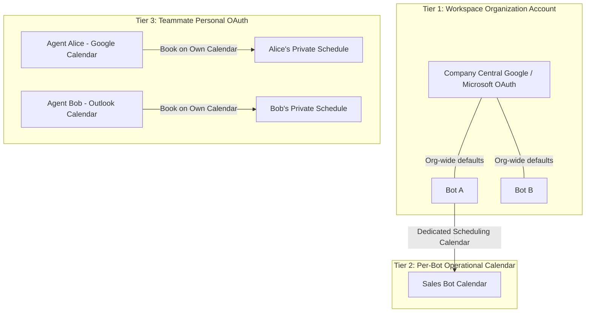

# Team Collaboration & Granular Permissions

Chatty provides enterprise-grade **Role-Based Access Control (RBAC)** and multi-operator collaboration. Whether managing a single support agent or coordinating cross-functional teams spanning engineering, marketing, content curation, and finance, Chatty ensures operators see only the tools they need while account owners retain ultimate administrative and billing authority.

---

## The 23 Dashboard Tabs Directory

Chatty's dashboard is organized into 5 operational domains encompassing 23 distinct permission tabs:

| Domain | Tab Key | Display Label | Capabilities & Purpose | Owner Only? |
| :--- | :--- | :--- | :--- | :--- |
| **Conversations & Support** | `inbox` | Live Inbox | Omnichannel live chat inbox, real-time visitor takeover, internal staff notes, and resolution tags. | No |
| | `playground` | Playground | Interactive sandbox to test bot prompts, inspect RAG retrieval chunks, citations, and model reasoning. | No |
| | `meetings` | Meetings | Appointment calendar, scheduled visitor meetings, video room URLs, and round-robin allocation. | No |
| | `mailbox` | Mailbox | Inbound/outbound email ticketing, Resend mailbox logs, message threading, and customer email replies. | No |
| **Intelligence & CRM** | `overview` | Overview | Executive performance scorecard, deflection rates, live visitor count, and operational KPIs. | No |
| | `leads` | Leads CRM | Captured visitor contact details, CRM intent scores, lead exports (CSV), and enriched metadata. | No |
| | `feedback` | Feedback & CSAT | Post-chat customer satisfaction ratings (CSAT), thumbs up/down, NPS scores, and friction tags. | No |
| | `analytics` | Analytics | Deflection rate trends, conversation duration, token consumption heatmaps, and sentiment analysis. | No |
| | `map` | Visitor Map | Real-time interactive Leaflet map plotting active visitor geolocations, cities, and countries. | No |
| **Content & Studio** | `knowledge` | Knowledge Base | RAG document uploads (PDF/DOCX/TXT), automated website sitemap crawling, and FAQ catalogs. | No |
| | `customizer` | Customizer | Chat widget theming, brand colors, avatar icons, launcher shapes, and live CSS styling preview. | No |
| | `flow_builder` | Flow Builder | Visual drag-and-drop conversational decision trees, branching paths, and lead capture nodes. | No |
| | `campaigns` | Campaigns | Proactive triggers, exit-intent modals, timed announcements, and audience targeting rules. | No |
| | `voice` | Voice Agent | LiveKit WebRTC bidirectional voice agent configuration, speech synthesis, and call audit logs. | No |
| **Operations & Controls** | `workspace` | Workspace | Multi-bot management, fast bot switching, clone/duplicate chatbots, and global model selector. | No |
| | `settings` | Agent Settings | AI model parameters, system prompts, guardrails, response temperature, and fallback behaviors. | No |
| | `team` | Team Roster | Manage team seats, invite teammates, configure granular tab permissions, and availability. | No |
| | `notifications` | Notifications | Incident alert policies, lead notification emails, Slack alerts, and SMS alert channels. | No |
| | `audit_log` | Audit Log | Immutable compliance audit trail logging configuration changes, member logins, and exports. | No |
| **Integrations & Developer** | `integrations` | Embed & Integrate | JavaScript widget embed snippets, allowed domains, CRM webhooks, and third-party tools. | No |
| | `developer` | Developer API | REST API keys, OAuth clients, outbound webhook subscriptions, and webhook test payloads. | No |
| | `mcp` | MCP Server | FastMCP Model Context Protocol tools, SSE endpoint, and connection instructions for AI IDEs. | No |
| | `billing` | Billing & Plans | Subscription tiers, Stripe customer portal, invoice downloads, and usage quota top-ups. | **Yes** |

<Note>
**Owner-Only Tab Protection**: The `billing` tab (and direct BYOK provider secret keys) is strictly reserved for the chatbot account owner. Non-owner administrators cannot view credit card details, initiate subscription changes, or grant themselves access to billing.
</Note>

---

## Standard Role Permission Matrix

Chatty includes 6 standardized industry roles with predefined default permission sets. When inviting a teammate, selecting their role automatically configures the recommended tabs:

| Dashboard Tab | Owner | Admin | Agent | Editor | Billing Manager | Viewer |
| :--- | :---: | :---: | :---: | :---: | :---: | :---: |
| **Overview** (`overview`) | <Check /> | <Check /> | <Check /> | <Check /> | <Check /> | <Check /> |
| **Live Inbox** (`inbox`) | <Check /> | <Check /> | <Check /> | <Check /> | — | <Check /> |
| **Playground** (`playground`) | <Check /> | <Check /> | <Check /> | <Check /> | — | — |
| **Meetings** (`meetings`) | <Check /> | <Check /> | <Check /> | — | — | — |
| **Mailbox** (`mailbox`) | <Check /> | <Check /> | <Check /> | — | — | — |
| **Leads CRM** (`leads`) | <Check /> | <Check /> | <Check /> | — | — | <Check /> |
| **Feedback & CSAT** (`feedback`) | <Check /> | <Check /> | <Check /> | — | — | <Check /> |
| **Visitor Map** (`map`) | <Check /> | <Check /> | — | — | — | <Check /> |
| **Analytics** (`analytics`) | <Check /> | <Check /> | — | — | <Check /> | <Check /> |
| **Knowledge Base** (`knowledge`) | <Check /> | <Check /> | — | <Check /> | — | — |
| **Customizer** (`customizer`) | <Check /> | <Check /> | — | <Check /> | — | — |
| **Flow Builder** (`flow_builder`) | <Check /> | <Check /> | — | <Check /> | — | — |
| **Campaigns** (`campaigns`) | <Check /> | <Check /> | — | <Check /> | — | — |
| **Voice Agent** (`voice`) | <Check /> | <Check /> | — | <Check /> | — | — |
| **Workspace** (`workspace`) | <Check /> | <Check /> | — | — | — | — |
| **Agent Settings** (`settings`) | <Check /> | <Check /> | — | — | — | — |
| **Team Roster** (`team`) | <Check /> | <Check /> | — | — | — | — |
| **Notifications** (`notifications`) | <Check /> | <Check /> | — | — | — | — |
| **Audit Log** (`audit_log`) | <Check /> | <Check /> | — | — | — | <Check /> |
| **Integrations** (`integrations`) | <Check /> | <Check /> | — | — | — | — |
| **Developer API** (`developer`) | <Check /> | <Check /> | — | — | — | — |
| **MCP Server** (`mcp`) | <Check /> | <Check /> | — | — | — | — |
| **Billing & Plans** (`billing`) | <Check /> | — | — | — | <Check /> | — |

### Role Profiles Summary
- **Owner**: Creator and primary account administrator with unrestricted access to all 23 tabs, billing management, and team governance.
- **Admin**: Operations lead with complete management authority over bot behavior, integrations, team members, and knowledge bases (all tabs except billing).
- **Agent**: Frontline support representative equipped for live conversations, ticket handling, meeting bookings, and lead follow-up.
- **Editor**: Content and growth curator specializing in training the knowledge base, designing widget themes, building conversation flows, and launching campaigns.
- **Billing Manager**: Financial administrator managing Stripe subscriptions, invoices, and performance ROI without exposing operational bot configuration.
- **Viewer / Analyst**: Read-only auditor or stakeholder monitoring CSAT scores, analytics trends, visitor telemetry, and lead capture.

### Intelligent Companion Tab Auto-Linking
When configuring permissions in the Chatty dashboard, checking certain primary tabs automatically suggests natural companion tabs:
- Selecting **Live Inbox** automatically suggests **Meetings**, **Mailbox**, and **Playground**.
- Selecting **Knowledge Base** or **Customizer** automatically suggests **Playground** for rapid testing.
- Selecting **Developer API** automatically suggests **MCP Server** and **Integrations**.

Unchecking any tab removes strictly that single tab, giving administrators full manual override.

---

## Multi-Tier Calendar Integration Architecture

Chatty cleanly separates calendar connections into three distinct architectural tiers:



1. **Tier 1 (Workspace Level)**: Organization-level Google Workspace or Microsoft 365 OAuth connection. Used as the default master calendar.
2. **Tier 2 (Per-Bot Level)**: Individual chatbots can be bound to a specific booking calendar (e.g. `sales@company.com` for Sales Bot, `support@company.com` for Support Bot).
3. **Tier 3 (Teammate Personal OAuth)**: Each invited team member can link their personal Google or Outlook account via secure OAuth.
   - **Bookable**: Enables the member to receive visitor appointments.
   - **Book on Own Calendar**: When enabled, round-robin appointments booked by visitors with this agent are created directly on the agent's personal calendar with automated video links (Google Meet, Zoom, or Teams). The rest of the team cannot view the agent's private calendar events.

<Tip>
**Billing Isolation**: Shared chatbots always charge usage, message quotas, and subscription costs to the **bot owner's billing account**. Teammates invited to collaborate are never billed for bot usage or seats on the shared bot.
</Tip>

---

## Round-Robin Scheduling & Out-of-Office (OOO) Delegation

For high-volume sales and customer support teams, Chatty automates appointment routing:

### 1. Round-Robin Load Balancing
When a website visitor requests a demo or support consultation:
1. The AI scheduler queries all team members marked as **Bookable**.
2. Members currently in a meeting or outside working hours are filtered out.
3. Appointments are distributed evenly across eligible agents to prevent staff burnout.

### 2. Out-of-Office (OOO) Delegation
When a team member takes leave or travels:
- The agent or an admin sets their **Out of Office** schedule in the **Team Roster** tab (`Start Date` to `End Date`).
- Chatty displays an `<Palmtree />` **OOO Active** badge next to the member.
- The scheduling engine **automatically bypasses** the out-of-office agent during this window, rerouting incoming bookings to available teammates without requiring manual rescheduling.

---

## FastMCP Server Support (`manage_team_members`)

Chatty provides full **Model Context Protocol (MCP)** support for team permissions! AI coding assistants (Claude Desktop, Cursor, Windsurf) and automated agents can programmatically manage teammates, assign roles, and customize tab permissions using the `manage_team_members` MCP tool.

### MCP Tool Specification: `manage_team_members`

```json
{
  "name": "manage_team_members",
  "description": "Invite, update, or remove team members for a chatbot, optionally setting custom tab permissions.",
  "parameters": {
    "type": "object",
    "properties": {
      "bot_id": {
        "type": "string",
        "description": "Unique chatbot identifier."
      },
      "action": {
        "type": "string",
        "enum": ["invite", "update", "remove"],
        "description": "Operation to perform."
      },
      "email": {
        "type": "string",
        "description": "Email address of the team member."
      },
      "role": {
        "type": "string",
        "enum": ["admin", "agent", "editor", "billing_manager", "viewer"],
        "default": "agent",
        "description": "Predefined role profile."
      },
      "permissions": {
        "type": "array",
        "items": { "type": "string" },
        "description": "Optional custom list of dashboard tab permissions. If omitted, uses role defaults."
      }
    },
    "required": ["bot_id", "action", "email"]
  }
}
```

### Example MCP Invocations

#### 1. Inviting an Editor with Standard Defaults
Invoking with `role: "editor"` automatically grants the standard Content & Studio tabs:

```json
{
  "bot_id": "bot_9f82a17c",
  "action": "invite",
  "email": "sarah.content@example.com",
  "role": "editor"
}
```

**Result**: Sarah receives access to `overview`, `customizer`, `knowledge`, `playground`, `flow_builder`, `campaigns`, `voice`, and `inbox`.

#### 2. Inviting a Support Specialist with Custom Granular Tabs
Administrators can override role defaults by providing an explicit `permissions` array:

```json
{
  "bot_id": "bot_9f82a17c",
  "action": "invite",
  "email": "alex.support@example.com",
  "role": "agent",
  "permissions": ["inbox", "meetings", "mailbox", "leads"]
}
```

#### 3. Removing a Team Member
```json
{
  "bot_id": "bot_9f82a17c",
  "action": "remove",
  "email": "contractor@example.com"
}
```

### Security Enforcement in MCP
The FastMCP server enforces identical RBAC boundaries as the web dashboard:
- **Ownership Escalation Protection**: An invite via MCP can never grant `owner` status.
- **Owner-Only Tab Sanitization**: If a non-owner administrator executes `manage_team_members` and attempts to grant `billing` or `byok`, the backend sanitization pipeline automatically strips those tabs before persisting to Supabase.
- **Audit Trail**: Every team mutation performed via MCP is logged to the immutable `chatty_audit_logs` table with the caller identity and timestamp.
